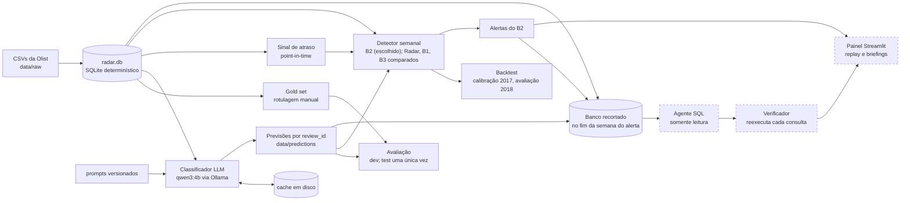
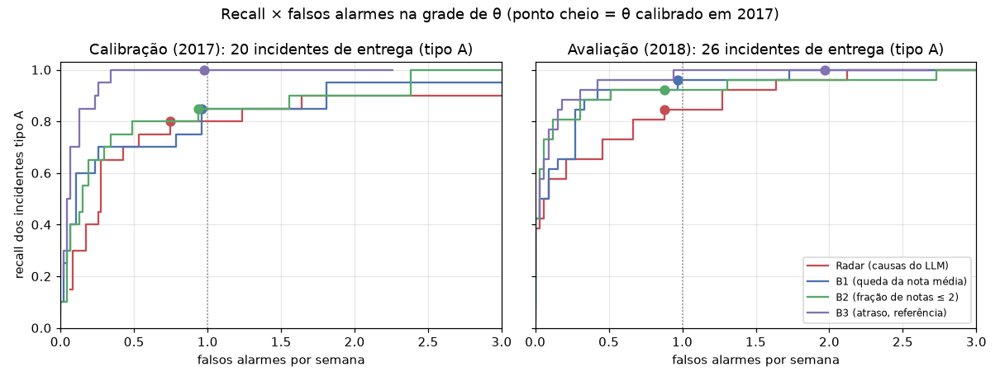

# Radar Operacional

Alerta precoce de problemas operacionais em e-commerce a partir das avaliações de clientes,
usando o dataset público da Olist (2016–2018), com um LLM local e custo zero de API.

> **Na detecção, uma linha de base simples basta; a IA agrega na investigação e na explicação
> do alerta, com cada número verificado.**
>
> No backtest de 2018, com os limiares fixados em 2017, o detector baseado nas causas que o LLM
> extrai dos comentários (o "Radar") detectou 22 de 26 incidentes de entrega. A simples fração
> de notas ≤ 2 (B2) detectou 24, com os mesmos 0,88 falsos alarmes por semana. Não houve
> antecedência: a mediana foi de 0 semana. Por isso, o desenho final usa o **B2 para detectar** e
> a camada de IA (classificações + agente investigador com verificador) **para explicar** o
> alerta ([D-053](docs/decisoes.md), uma decisão tomada depois de ver a avaliação e declarada
> como tal).

**Estado atual:**
- Concluídos e avaliados: o classificador de causa (test set usado uma única vez), a
  classificação em lote e o backtest do detector (avaliação de 2018 rodada uma única vez).
- Em andamento: o agente investigador. Ele já tem 9 alertas selecionados e o piloto ainda vai
  rodar, então a parte "a IA agrega na investigação" ainda está sendo medida. O painel também
  está em andamento. Veja [Em andamento](#em-andamento).
- Todos os números abaixo vêm de relatórios gerados por scripts versionados em `reports/`.

## O problema

Um marketplace recebe milhares de avaliações por semana. A nota média mostra que algo piorou,
mas não diz **o quê**, **onde** nem **desde quando**. O projeto tenta responder à pergunta do
gestor de operações: *tem algo quebrando agora, onde, desde quando e qual o impacto?*

A hipótese inicial era que o texto dos comentários diz a causa do problema (entrega, produto,
pedido errado, atendimento) e que essa causa, agregada por estado ou categoria e semana,
sinaliza incidentes melhor que a nota. O backtest **não confirmou** a parte da detecção (veja
[Resultados](#detector-backtest-semanal-fase-7)). Continua de pé a parte da explicação: dizer
qual é a causa e onde ela está.

## Desenho final em 3 camadas

1. **Detector: B2.** É a fração de avaliações com nota ≤ 2 respondidas na semana, comparada com
   a mediana das 26 semanas anteriores. O limiar foi calibrado em 2017 (θ = 2,0).
   - O Radar, que usa as causas classificadas pelo LLM, foi avaliado com as mesmas regras e
     continua no repositório como o método comparado.
   - O backtest é point-in-time: a semana *t* só usa o que já existia em *t*. A definição de
     incidente e os períodos foram congelados antes de existir qualquer detector
     ([D-026](docs/decisoes.md)).
2. **Classificador de causa.** Cada comentário com nota ≤ 3 vira um JSON validado por Pydantic,
   com causa, gravidade, confiança e justificativa. A área responsável é derivada da causa.
   - O classificador é medido contra um gold set de 250 avaliações rotuladas à mão. O LLM nunca
     pré-rotulou nada.
   - Taxonomia de 8 classes em [docs/taxonomia.md](docs/taxonomia.md).
3. **Agente investigador com verificação.** Diante de um alerta do B2, um agente investiga via
   SQL e escreve um briefing com a causa, os segmentos, vendedores e pedidos afetados e o
   impacto.
   - O acesso é somente leitura, num banco recortado no fim da semana do alerta: o agente só vê
     o que se sabia ali.
   - Cada número do briefing aponta para a consulta que o gerou, e o verificador a reexecuta.

## Arquitetura



Contorno tracejado: código e testes prontos, resultados em andamento (veja
[Em andamento](#em-andamento)).

## Resultados

### Detector: backtest semanal (Fase 7)

São 34 segmentos (13 estados e 21 categorias). Os incidentes vêm de um gabarito objetivo
congelado antes do detector (D-026):
- **tipo A:** surto de atraso point-in-time;
- **tipo B:** surto de notas ≤ 2 entre pedidos entregues no prazo.

O θ de cada método é o menor da grade com no máximo 1 falso alarme por semana na calibração
(2017-02-06 a 2017-12-25). Ele foi aplicado sem mudança na avaliação (2018-01-01 a 2018-08-13),
que rodou uma única vez.

**Avaliação de 2018** ([`reports/backtest.md`](reports/backtest.md)), no θ calibrado:

| método | θ | alertas | falsos alarmes | FA/semana | recall A | recall B |
|---|---|---|---|---|---|---|
| Radar (causas do LLM) | 3,25 | 114 | 29 | 0,88 | 22/26 | 1/1 |
| B1 (queda da nota média) | 1,75 | 166 | 32 | 0,97 | 25/26 | 1/1 |
| **B2 (fração de notas ≤ 2)** | 2,00 | 149 | 29 | 0,88 | **24/26** | 1/1 |
| B3 (atraso, referência) | 1,25 | 248 | 65 | 1,97 | 26/26 | 1/1 |



A curva completa está em `reports/curva_*.csv` e a figura é gerada por
`python -m src.detection.plot_curve`. Como os métodos param em níveis diferentes de falsos
alarmes, a tabela abaixo compara o recall A em níveis iguais.

| FA/semana ≤ | Radar | B1 | B2 | B3 |
|---|---|---|---|---|
| 0,25 | 17/26 | 17/26 | 21/26 | 23/26 |
| 0,50 | 19/26 | 24/26 | 23/26 | 25/26 |
| 0,75 | 21/26 | 24/26 | 24/26 | 25/26 |

Essa tabela é só descritiva: o θ de cada nível é escolhido olhando 2018. O resultado principal é
o do θ calibrado.

**O que o backtest mostrou:**
- **O Radar não supera as linhas de base na detecção.** Em todos os níveis da curva ele fica
  igual ou atrás do B2. O B3 lidera, mas ele mede o atraso, que é a mesma variável que define o
  incidente A, então funciona como teto de referência e não como concorrente.
- **Sem antecedência.** Contra B1 e B2, a mediana é de 0 semana. A média é de −0,73 contra B1
  e −0,10 contra B2: o Radar detecta, em média, um pouco depois. Era o esperado pela Fase 1, que
  mostrou que a nota não atrasa em relação ao atraso das entregas.
- **O diagnóstico de causa fica pouco acima da taxa de base.** No alerta que detectou o
  incidente, a família do Radar é `entrega` em 19 de 22 incidentes A (86%). Mas 88 de todos os
  114 alertas do Radar (77%) já são `entrega`, então o acerto está pouco acima do chute pela
  frequência. Em 2017, foram 11 de 16 (69%) contra 40 de 70 (57%).
- **Calibração de 2017** ([`reports/backtest_calibracao.md`](reports/backtest_calibracao.md)):
  o recall A foi de 16/20 para o Radar, 17/20 para B1 e B2 e 20/20 para o B3.

### Classificação em lote (Fase 6)

- **Volume:** 41.281 comentários. Os 14.888 com nota ≤ 3 foram classificados, e as notas 4–5
  ficaram como `nao_classificado` (D-039).
- **Falhas de schema:** 0. Todas as classificações saíram na 1ª tentativa.
- **Tempo:** cerca de 5,5 h de GPU, com mediana de 1,36 s por chamada.
- **Integridade:** a checagem `python -m src.eval.integridade`, com critérios versionados antes
  do fim do lote (D-051), passou inteira.
- **Causas mais frequentes:** `problema_entrega` 5.600, `produto_diferente_do_anunciado` 2.618 e
  `pedido_incompleto_ou_errado` 2.423.

### Classificador de causa: test set, avaliação única (Fase 5)

| | macro-F1 [IC 95%] | acurácia | falha de schema | s/item |
|---|---|---|---|---|
| **LLM local `qwen3:4b`, sem raciocínio** | **0,657** [0,518; 0,754] | 0,810 | 0 de 150 | 1,7 s |
| baseline TF-IDF + regressão logística | 0,422 [0,336; 0,492] | 0,708 | — | < 1 ms |

Fonte: [`reports/fase5_test.md`](reports/fase5_test.md). São 137 itens não ambíguos e 8 classes.
O IC é por bootstrap.

**O que mais os experimentos mostraram:**
- **Raciocínio não compensou o custo.** No dev, o modo com raciocínio do `qwen3:4b` empatou
  dentro do ruído, com macro-F1 de 0,823 contra 0,846, e custou cerca de 20 vezes mais tempo:
  28 s contra 1,4 s por item ([`reports/fase3_dev.md`](reports/fase3_dev.md)). A configuração
  principal ficou sem raciocínio.
- **A v2 do prompt foi rejeitada pela regra definida antes de rodá-la.**
  - A regra (D-044) exigia: macro-F1 maior ou igual, nenhum acerto perdido em classe rara e
    nenhuma falha de schema a mais.
  - A v2 subiu o macro-F1 no dev (0,864 contra 0,846), mas perdeu um acerto em `outro`, uma
    classe rara.
  - No total, ficou em 87 acertos contra 87, com 3 ganhos e 3 perdas
    ([`reports/fase4_dev.md`](reports/fase4_dev.md)). A v1 continuou.
- **A queda do dev para o test é real e está explicada** (macro-F1 0,846 → 0,657).
  - Quase toda ela está em `qualidade_insatisfatoria`, com recall de 0,17 no test: o modelo
    manda esses itens para `defeito` ou `diferente`.
  - A causa provável é a taxonomia. A classe nasceu do remapeamento mecânico de uma nota da
    rotulagem, e a definição escrita favorece as outras duas classes.
  - Os rótulos não foram alterados para favorecer o modelo ([D-041](docs/decisoes.md)).
- **O baseline usa a nota como atalho e o LLM não.** No test, o baseline previu `elogio` em 7 de
  8 avaliações de nota 4–5 que tinham um problema; o LLM, em 0 de 8.
- **Observação feita depois do test, fora do protocolo:** o erro de causa fica quase sempre
  dentro da mesma área responsável. O acerto de área do LLM é 0,927, e 45 de 46 itens da área
  `vendedor` ficam com a área certa.

### Gold set e dados (Fases 1 e 2)

- **Gold set:** 250 avaliações, 50 por nota, divididas em 100 dev e 150 test e sorteadas antes
  da rotulagem. 17 itens (6,8%) foram marcados como ambíguos e ficam fora das métricas
  ([`reports/gold_set.md`](reports/gold_set.md)).
- **Comentários classificáveis:** 41.281 avaliações (41,6%) têm comentário com conteúdo
  ([`reports/fase1_dados.md`](reports/fase1_dados.md)).
- **Achado que orientou o backtest:** no agregado nacional, a nota média **não atrasa** em
  relação ao atraso objetivo das entregas. A correlação mais forte aparece na mesma semana ou
  uma antes (−0,772 em *k* = −1). A expectativa declarada antes do backtest era de pouca
  antecedência em problemas de entrega (D-025, D-026), e o backtest a confirmou.

## Em andamento

| Etapa | Situação |
|---|---|
| **Fase 8:** agente investigador com verificador, sobre alertas do B2 | código e testes prontos; banco de classificações gerado; 9 alertas de 2018 selecionados com critério fixado antes de rodar (variados: famílias diferentes, caso típico, fim dos dados, o caso de um vendedor e falsos alarmes, [D-054](docs/decisoes.md)); o piloto com 3 alertas é o próximo passo |
| **Fase 9:** painel Streamlit (linha do tempo de alertas, replay por semana, briefings com selo por afirmação) | lê os alertas reais do backtest; os briefings entram quando o agente rodar |
| **Fase 5 (complemento):** modo com raciocínio no test, só como comparação | agendado para uma janela ociosa de GPU (cerca de 80 min) |
| **Fase 10:** README final com o estudo de caso do agente e um GIF do painel | depois da Fase 8 |

## Como o projeto evita se enganar

- **Test set usado uma única vez**, com a configuração escolhida no dev. Nada foi ajustado
  depois ([D-045](docs/decisoes.md)).
- **Avaliação do backtest rodada uma única vez**, com os θ de 2017 e só depois de uma checagem
  de integridade do lote versionada antes ([D-051](docs/decisoes.md)).
- **Regras de aceite e de escolha fixadas e versionadas antes de rodar.** Valem para a v2 do
  prompt, o limiar de confiança, a definição de incidente, os períodos do backtest, os detalhes
  da regra de alerta e os alertas que o agente investiga (D-026, D-044, D-048, D-054).
- **Gold set rotulado à mão, sem pré-rotulagem por LLM,** e nunca alterado com base em
  previsões. Discordâncias em que a regra escrita apoia o modelo aparecem só numa métrica
  secundária identificada (D-041).
- **Sinal de atraso point-in-time** e disponibilidade da avaliação pela data de resposta
  (D-019, D-025). O agente investiga num banco recortado no fim da semana do alerta (D-050).
- **Decisões tomadas depois de ver um resultado aparecem como tal.** São os casos da família
  "produto" no detector (D-047) e do desenho final com o B2 como detector (D-053). Os resultados
  que motivaram essas decisões não foram recalculados.
- **Cada decisão tem entrada própria em [docs/decisoes.md](docs/decisoes.md),** com o motivo e
  o que foi descartado.

## LLM local, custo zero

Todo o uso de LLM roda localmente com o [Ollama](https://ollama.com) e o `qwen3:4b`
(RTX 4050, 6 GB de VRAM).
- **Custo:** zero em dinheiro, e as avaliações não saem da máquina.
- **Métrica de custo:** como cada chamada custa segundos de GPU, os relatórios medem o **tempo
  de processamento** (`python -m src.llm`).
- **Alternativa paga:** o provedor da Anthropic continua disponível como opção (D-010 a D-013).

## Como rodar

Requer Python 3.11+ (desenvolvido em 3.12) e, para as etapas com LLM, o
[Ollama](https://ollama.com/download).

```bash
python -m venv .venv
.venv\Scripts\activate          # Windows  (Linux/macOS: source .venv/bin/activate)
pip install -r requirements-dev.txt
pytest                          # 129 testes rápidos, sem LLM nem dados
```

**Dados:** baixe o [Brazilian E-Commerce Public Dataset by Olist](https://www.kaggle.com/datasets/olistbr/brazilian-ecommerce)
e coloque os CSVs em `data/raw/`. Os dados brutos e o banco derivado não são versionados.

```bash
python -m src.data.make_db           # data/processed/radar.db (determinístico, ~20 s)
python -m src.data.stats             # reports/fase1_dados.md + figuras
```

**Relatórios sem GPU.** As previsões estão versionadas em `data/predictions/`, sem texto,
inclusive o lote completo da Fase 6. Os relatórios saem delas e do banco gerado acima:

```bash
python -m src.labeling.report        # reports/gold_set.md
python -m src.eval.dev_report        # reports/fase3_dev.md (baseline, v1, v1 com raciocínio, v2)
python -m src.eval.fase4_report      # reports/fase4_dev.md (regra de aceite, limiar)
python -m src.eval.test_report       # reports/fase5_test.md
python -m src.eval.integridade       # checagem do lote (D-051)
python -m src.detection.backtest --period calibracao   # θ por método (2017), ~35 s
python -m src.detection.backtest --period avaliacao    # reports/backtest.md (2018), ~40 s
python -m src.detection.plot_curve   # reports/figures/curva_backtest.png
python -m src.agent.classifications  # data/processed/classificacoes.db, para o agente
python -m src.agent.targets          # reports/agente_alvos.csv (alertas do B2, D-054)
```

**Com o modelo local.** Os comandos com mais de 50 chamadas exigem `--confirm`. O test set só é
liberado com `--allow-test`, reservado à avaliação da Fase 5.

```bash
ollama pull qwen3:4b                                       # ~2,5 GB
pytest -m ollama                                           # teste real com o modelo (2 chamadas)
python -m src.classifier.run --role classifier --limit 5   # tempo por item em 5 itens do dev
python -m src.classifier.baseline                          # baseline com validação cruzada no dev
python -m src.classifier.batch --estimate                  # Fase 6: contagem e tempo estimado
python -m src.agent.run --pilot                            # Fase 8: estimativa do piloto
```

**Rotulagem** (ferramenta usada no gold set; não chama LLM) e **painel**:

```bash
streamlit run src/labeling/app.py    # http://127.0.0.1:8501
streamlit run src/app/painel.py      # alertas do backtest e briefings do agente
```

**Modo reprodutível.** Toda chamada ao LLM passa por um cache em disco (`cache/llm/`, não
versionado, porque contém os textos das avaliações). Com `RADAR_LLM_MODE=cache_only`, nenhum
modelo é chamado, e uma requisição ausente do cache gera erro. O `.env` é opcional (veja
`.env.example`).

## Limitações

_(As do agente entram quando a Fase 8 tiver resultados.)_

**Backtest:**
- **Dois episódios dominam o gabarito.** Dos 21 incidentes de 2017, 15 começam entre
  2017-11-27 e 2017-12-18, no fim de ano. Dos 26 incidentes A de 2018, 21 começam entre
  2018-02-26 e 2018-03-19, em vários estados e categorias ao mesmo tempo. Na prática, o
  backtest mede dois episódios sistêmicos de atraso.
- **O "n" efetivo é pequeno.** Incidentes do mesmo episódio não são independentes, então 26
  incidentes valem bem menos que 26 observações. As diferenças de 1 ou 2 incidentes entre
  métodos estão dentro do ruído.
- **Há 1 incidente tipo B por período.** Os recalls de 0/1 e 1/1 não dizem nada sobre
  problemas que não são de entrega. Era justamente aí que o Radar poderia agregar, e o gabarito
  não consegue medir isso.
- **O θ do B3 não se transferiu:** os falsos alarmes foram de 0,98 por semana em 2017 para 1,97
  em 2018. Nos outros métodos o nível se manteve (Radar de 0,74 para 0,88; B1 de 0,96 para 0,97;
  B2 de 0,94 para 0,88).
- **O B3 leva vantagem por construção:** ele mede a mesma variável que define o incidente A.
- **Um mesmo alerta pode casar com dois incidentes** seguidos do mesmo segmento, e várias
  detecções caem no limite da janela, 4 semanas antes do início. Antecedências grandes precisam
  ser conferidas caso a caso ([D-052](docs/decisoes.md)).
- **Vendedor não é segmento de detecção** (D-021). O caso de um vendedor problemático examinado
  pelas categorias dele não aparece na principal delas. Ele fica para o aprofundamento do
  agente.

**Classificador e dados:**
- **Classificador:** macro-F1 de 0,657 no test, com IC largo, porque o gold set é pequeno (150
  itens no test).
  - `qualidade_insatisfatoria` não é confiável (recall de 0,17).
  - `problema_atendimento_ou_comunicacao` e `outro` têm poucos exemplos (2 e 3 no test).
- **Só comentários com nota ≤ 3 são classificados** (D-039). As notas 4–5 ficam como
  `nao_classificado`, nunca como `elogio`.
  - Pela estimativa no dev, perde-se cerca de 12% do volume de problemas e boa parte das
    reclamações de atendimento, que aparecem em notas altas.
  - A estimativa para atendimento é incerta: 5 itens no gold set, e os splits discordam.
- **Seleção do dataset:** só existem pedidos que receberam pesquisa até 31/08/2018. As últimas
  semanas são censuradas (D-020).
- **Área responsável por mapeamento fixo** (D-027, D-034): avaria no transporte cai em
  `vendedor`, e cancelamento por falta de estoque cai em `logistica`.
- **Banco recortado do agente:** a data de cancelamento não existe no dataset, então um pedido
  cancelado antes do corte aparece como aprovado (D-050).

## Estrutura

```
config.yaml          provedor e modelo do LLM, caminhos, modo do cache
data/raw/            CSVs da Olist (não versionados)
data/processed/      bancos SQLite derivados (não versionados)
data/gold/           gold set: IDs, divisão dev/test e rótulos manuais (sem texto)
data/predictions/    previsões por review_id, inclusive o lote da Fase 6 (sem texto)
data/samples/        IDs de amostras auxiliares
docs/                plano, decisões (D-001…), taxonomia, análise de erros
prompts/             prompts versionados do classificador e do agente
reports/             relatórios, alertas, curvas e figuras gerados por script
src/data/            carga, limpeza, sinal de atraso point-in-time, banco, estatísticas
src/labeling/        amostra do gold set, ferramenta de rotulagem, migração v1.1, relatório
src/classifier/      LLM (schema, prompt, execução, lote) e baseline
src/eval/            métricas e relatórios do classificador, checagem do lote
src/detection/       detector, gabarito de incidentes, backtest e figura da curva
src/agent/           SQL somente leitura, banco recortado, seleção de alertas, verificador, agente
src/llm/             cliente de LLM (Ollama/Anthropic), cache em disco, uso
src/app/             painel Streamlit (replay, alertas, briefings)
tests/               pytest
```

## Documentação

- [docs/plano.md](docs/plano.md): fases, regras de conduta e protocolo de checkpoint.
- [docs/decisoes.md](docs/decisoes.md): log de decisões, com motivo e alternativas.
- [docs/taxonomia.md](docs/taxonomia.md): taxonomia v1.1 de causas.
- [docs/erros.md](docs/erros.md): análise de erros do classificador.

## Dados e licença

O dataset da Olist é distribuído sob CC BY-NC-SA 4.0. O repositório não contém os dados
brutos: só IDs, rótulos, previsões, agregados e trechos curtos citados como exemplo na
taxonomia.
