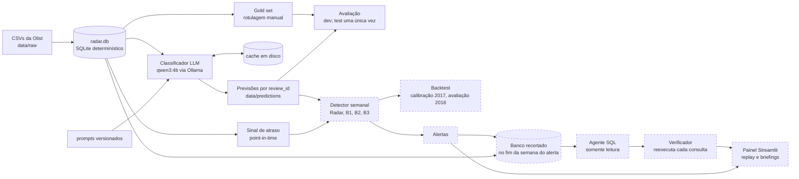

# Radar Operacional

Alerta precoce de problemas operacionais em e-commerce a partir das avaliações de clientes,
usando o dataset público da Olist (2016–2018), com um LLM local e custo zero de API.

> **Estado atual:** o classificador de causa está concluído e avaliado no test set, com uma
> avaliação única. O backtest do detector, o agente investigador e o painel estão em
> andamento: o código e os testes existem, mas ainda não há resultados. Veja
> [Em andamento](#em-andamento). Os números abaixo vêm de relatórios gerados por scripts
> versionados em `reports/`.

## O problema

Um marketplace recebe milhares de avaliações por semana. A nota média mostra que algo piorou,
mas não diz **o quê**, **onde** nem **desde quando**. O projeto tenta responder à pergunta do
gestor de operações: *tem algo quebrando agora, onde, desde quando e qual o impacto?*

A hipótese é que o texto dos comentários diz a causa do problema (entrega, produto, pedido
errado, atendimento) e que, agregada por estado ou categoria e semana, essa causa sinaliza
incidentes com mais informação que a queda da nota.

## A solução em 3 camadas

1. **Classificador de causa.** Cada comentário vira um JSON validado por Pydantic com causa,
   gravidade, confiança e justificativa; a área responsável é derivada da causa.
   - O classificador é medido contra um gold set de 250 avaliações rotuladas à mão. O LLM nunca
     pré-rotulou nada.
   - Taxonomia de 8 classes em [docs/taxonomia.md](docs/taxonomia.md).
2. **Detector de anomalias com backtest semanal sem vazamento.**
   - Agrega as causas por estado e categoria e compara o Radar com linhas de base: queda da nota
     média, fração de notas baixas e atraso objetivo.
   - Mede a antecedência, o recall de incidentes e os falsos alarmes por semana.
   - Tudo é point-in-time: a semana *t* só usa o que já existia em *t*. A definição de incidente
     e os períodos de calibração e avaliação foram congelados antes de existir qualquer
     detector ([D-026](docs/decisoes.md)).
3. **Agente investigador com verificação.** Diante de um alerta, um agente investiga via SQL e
   escreve um briefing.
   - O acesso ao banco é somente leitura, num banco recortado no fim da semana do alerta.
   - Cada número do briefing aponta para a consulta que o gerou, e o verificador a reexecuta.

## Arquitetura



Contorno tracejado: código e testes prontos, resultados em andamento (veja
[Em andamento](#em-andamento)).

## Resultados até aqui

### Classificador de causa: test set, avaliação única (Fase 5)

| | macro-F1 [IC 95%] | acurácia | falha de schema | s/item |
|---|---|---|---|---|
| **LLM local `qwen3:4b`, sem raciocínio** | **0,657** [0,518; 0,754] | 0,810 | 0 de 150 | 1,7 s |
| baseline TF-IDF + regressão logística | 0,422 [0,336; 0,492] | 0,708 | — | < 1 ms |

Fonte: [`reports/fase5_test.md`](reports/fase5_test.md). São 137 itens não ambíguos e 8 classes.
O IC é por bootstrap.

**O que mais os experimentos mostraram:**
- **Raciocínio não compensou o custo.** No dev, o modo com raciocínio do `qwen3:4b` empatou
  dentro do ruído, com macro-F1 de 0,823 contra 0,846, e custou cerca de 20 vezes mais tempo:
  28 s contra 1,4 s por item ([`reports/fase3_dev.md`](reports/fase3_dev.md)). A configuração
  principal ficou sem raciocínio.
- **A v2 do prompt foi rejeitada pela regra definida antes de rodá-la.**
  - A regra (D-044) exigia: macro-F1 maior ou igual, nenhum acerto perdido em classe rara e
    nenhuma falha de schema a mais.
  - A v2 subiu o macro-F1 no dev (0,864 contra 0,846), mas perdeu um acerto em `outro`, uma
    classe rara.
  - No total, ficou em 87 acertos contra 87, com 3 ganhos e 3 perdas
    ([`reports/fase4_dev.md`](reports/fase4_dev.md)). A v1 continuou.
- **A queda do dev para o test é real e está explicada** (macro-F1 0,846 → 0,657).
  - Quase toda ela está em `qualidade_insatisfatoria`, com recall de 0,17 no test: o modelo
    manda esses itens para `defeito` ou `diferente`.
  - A causa provável é a taxonomia. A classe nasceu do remapeamento mecânico de uma nota da
    rotulagem, e a definição escrita favorece as outras duas classes.
  - Os rótulos não foram alterados para favorecer o modelo ([D-041](docs/decisoes.md)).
- **O baseline usa a nota como atalho e o LLM não.** No test, o baseline previu `elogio` em 7 de
  8 avaliações de nota 4–5 que tinham um problema; o LLM, em 0 de 8.
- **Observação feita depois do test, fora do protocolo:** o erro de causa fica quase sempre
  dentro da mesma área responsável. O acerto de área do LLM é 0,927, e 45 de 46 itens da área
  `vendedor` ficam com a área certa.

### Gold set e dados (Fases 1 e 2)

- **Gold set:** 250 avaliações, 50 por nota, divididas em 100 dev e 150 test e sorteadas antes
  da rotulagem. 17 itens (6,8%) foram marcados como ambíguos e ficam fora das métricas
  ([`reports/gold_set.md`](reports/gold_set.md)).
- **Comentários classificáveis:** 41.281 avaliações (41,6%) têm comentário com conteúdo
  ([`reports/fase1_dados.md`](reports/fase1_dados.md)).
- **Achado que orienta o backtest:**
  - No agregado nacional, a nota média **não atrasa** em relação ao atraso objetivo das
    entregas. A correlação mais forte aparece na mesma semana ou uma antes (−0,772 em
    *k* = −1).
  - Por isso, a expectativa declarada antes do backtest é de pouca antecedência sobre a nota em
    problemas de entrega.
  - Nesse caso, o valor do Radar estaria no **diagnóstico de causa** e nos problemas que não
    são de entrega (D-025, D-026).

## Em andamento

| Etapa | Situação |
|---|---|
| **Fase 6:** classificação em lote dos comentários com nota ≤ 3 (14.888 chamadas, cerca de 6 h de GPU) | rodando; retomável pelo cache |
| **Fase 7:** backtest do Radar contra B1 (nota média), B2 (notas ≤ 2) e B3 (atraso) | código e testes prontos; a calibração em 2017 roda quando o lote cobrir 2017, e a avaliação em 2018, uma única vez, com o lote completo |
| **Fase 8:** agente investigador com verificador | código e testes prontos, com provedor simulado; as chamadas reais ao modelo ficam para depois do lote, para não disputar a GPU |
| **Fase 5 (complemento):** modo com raciocínio no test, só como comparação | depois do lote |
| **Fase 9:** painel Streamlit (linha do tempo de alertas, replay por semana, briefings com selo por afirmação) | esqueleto pronto, com dados sintéticos sinalizados; passa a ler os alertas e briefings reais quando existirem |

## Como o projeto evita se enganar

- **Test set usado uma única vez**, com a configuração escolhida no dev. Nada foi ajustado
  depois ([D-045](docs/decisoes.md)).
- **Regras de aceite e de escolha fixadas e versionadas antes de rodar.** Valem para a v2 do
  prompt, o limiar de confiança, a definição de incidente, os períodos do backtest e os
  detalhes da regra de alerta (D-026, D-044, D-048).
- **Gold set rotulado à mão, sem pré-rotulagem por LLM,** e nunca alterado com base em
  previsões. Discordâncias em que a regra escrita apoia o modelo aparecem só numa métrica
  secundária identificada (D-041).
- **Sinal de atraso point-in-time** e disponibilidade da avaliação pela data de resposta
  (D-019, D-025).
- **Decisões tomadas depois de ver o test aparecem como tal.** É o caso da família "produto" no
  detector (D-047).
- **Cada decisão tem entrada própria em [docs/decisoes.md](docs/decisoes.md),** com o motivo e
  o que foi descartado.

## LLM local, custo zero

Todo o uso de LLM roda localmente com o [Ollama](https://ollama.com) e o `qwen3:4b`
(RTX 4050, 6 GB de VRAM).
- **Custo:** zero em dinheiro, e as avaliações não saem da máquina.
- **Métrica de custo:** como cada chamada custa segundos de GPU, os relatórios medem o **tempo
  de processamento** (`python -m src.llm`).
- **Alternativa paga:** o provedor da Anthropic continua disponível como opção (D-010 a D-013).

## Como rodar

Requer Python 3.11+ (desenvolvido em 3.12) e, para as etapas com LLM, o
[Ollama](https://ollama.com/download).

```bash
python -m venv .venv
.venv\Scripts\activate          # Windows  (Linux/macOS: source .venv/bin/activate)
pip install -r requirements-dev.txt
pytest                          # 126 testes rápidos, sem LLM nem dados
```

**Dados:** baixe o [Brazilian E-Commerce Public Dataset by Olist](https://www.kaggle.com/datasets/olistbr/brazilian-ecommerce)
e coloque os CSVs em `data/raw/`. Os dados brutos e o banco derivado não são versionados.

```bash
python -m src.data.make_db           # data/processed/radar.db (determinístico, ~20 s)
python -m src.data.stats             # reports/fase1_dados.md + figuras
```

**Relatórios do classificador sem GPU.** As previsões estão versionadas em `data/predictions/`,
sem texto, e os relatórios saem delas. Eles precisam do banco gerado acima, para os pesos por
nota e o sinal de entrega:

```bash
python -m src.labeling.report        # reports/gold_set.md
python -m src.eval.dev_report        # reports/fase3_dev.md (baseline, v1, v1 com raciocínio, v2)
python -m src.eval.fase4_report      # reports/fase4_dev.md (regra de aceite, limiar)
python -m src.eval.test_report       # reports/fase5_test.md
```

**Com o modelo local.** Os comandos com mais de 50 chamadas exigem `--confirm`. O test set só é
liberado com `--allow-test`, reservado à avaliação da Fase 5.

```bash
ollama pull qwen3:4b                                       # ~2,5 GB
pytest -m ollama                                           # teste real com o modelo (2 chamadas)
python -m src.classifier.run --role classifier --limit 5   # tempo por item em 5 itens do dev
python -m src.classifier.baseline                          # baseline com validação cruzada no dev
python -m src.classifier.batch --estimate                  # Fase 6: contagem e tempo estimado
```

**Rotulagem** (ferramenta usada no gold set; não chama LLM) e **painel**:

```bash
streamlit run src/labeling/app.py    # http://127.0.0.1:8501
streamlit run src/app/painel.py      # dados sintéticos até o backtest gerar alertas
```

**Modo reprodutível.** Toda chamada ao LLM passa por um cache em disco (`cache/llm/`, não
versionado, porque contém os textos das avaliações). Com `RADAR_LLM_MODE=cache_only`, nenhum
modelo é chamado, e uma requisição ausente do cache gera erro. O `.env` é opcional (veja
`.env.example`).

## Limitações

_(Lista parcial; será completada com os resultados do backtest e do agente.)_

- **Classificador:** macro-F1 de 0,657 no test, com IC largo, porque o gold set é pequeno (150
  itens no test).
  - `qualidade_insatisfatoria` não é confiável (recall de 0,17).
  - `problema_atendimento_ou_comunicacao` e `outro` têm poucos exemplos (2 e 3 no test).
- **Só comentários com nota ≤ 3 são classificados** (D-039). As notas 4–5 ficam como
  `nao_classificado`, nunca como `elogio`.
  - Pela estimativa no dev, perde-se cerca de 12% do volume de problemas e boa parte das
    reclamações de atendimento, que aparecem em notas altas.
  - A estimativa para atendimento é incerta: 5 itens no gold set, e os splits discordam.
- **Seleção do dataset:** só existem pedidos que receberam pesquisa até 31/08/2018. As últimas
  semanas são censuradas (D-020).
- **Área responsável por mapeamento fixo** (D-027, D-034): avaria no transporte cai em
  `vendedor`, e cancelamento por falta de estoque cai em `logistica`.
- **Banco recortado do agente:** a data de cancelamento não existe no dataset, então um pedido
  cancelado antes do corte aparece como aprovado (D-050).

## Estrutura

```
config.yaml          provedor e modelo do LLM, caminhos, modo do cache
data/raw/            CSVs da Olist (não versionados)
data/processed/      banco SQLite derivado (não versionado)
data/gold/           gold set: IDs, divisão dev/test e rótulos manuais (sem texto)
data/predictions/    previsões por review_id (sem texto)
data/samples/        IDs de amostras auxiliares
docs/                plano, decisões (D-001…), taxonomia, análise de erros
prompts/             prompts versionados do classificador e do agente
reports/             relatórios gerados por script
src/data/            carga, limpeza, sinal de atraso point-in-time, banco, estatísticas
src/labeling/        amostra do gold set, ferramenta de rotulagem, migração v1.1, relatório
src/classifier/      LLM (schema, prompt, execução, lote) e baseline
src/eval/            métricas e relatórios do classificador
src/detection/       detector, gabarito de incidentes e backtest
src/agent/           SQL somente leitura, banco recortado, verificador e agente
src/llm/             cliente de LLM (Ollama/Anthropic), cache em disco, uso
src/app/             painel Streamlit (replay, alertas, briefings)
tests/               pytest
```

## Documentação

- [docs/plano.md](docs/plano.md): fases, regras de conduta e protocolo de checkpoint.
- [docs/decisoes.md](docs/decisoes.md): log de decisões, com motivo e alternativas.
- [docs/taxonomia.md](docs/taxonomia.md): taxonomia v1.1 de causas.
- [docs/erros.md](docs/erros.md): análise de erros do classificador.

## Dados e licença

O dataset da Olist é distribuído sob CC BY-NC-SA 4.0. O repositório não contém os dados
brutos: só IDs, rótulos, previsões, agregados e trechos curtos citados como exemplo na
taxonomia.
