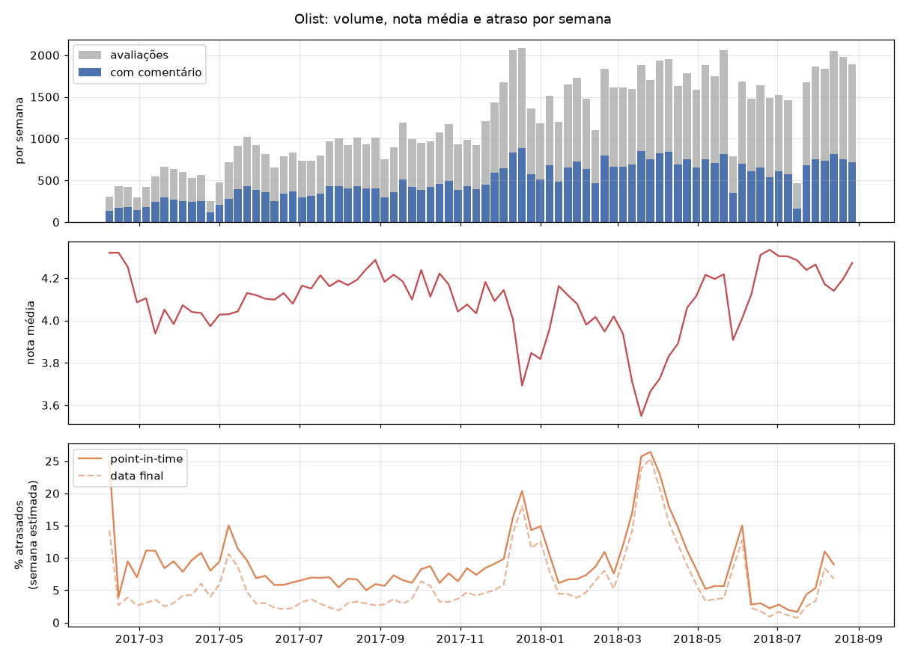
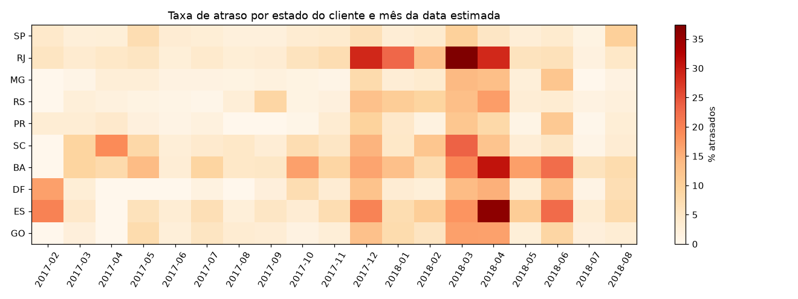
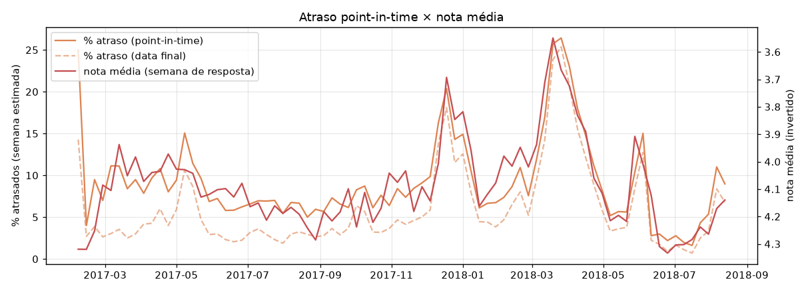

# Fase 1 — Dados: estatísticas descritivas e exploração temporal

_Gerado por `python -m src.data.stats` a partir de `data/processed/radar.db`. Não edite à mão._

## 1. Tabelas do banco

| tabela | linhas |
|---|---|
| order_items | 112650 |
| order_segments | 298921 |
| orders | 99441 |
| payments | 103886 |
| products | 32951 |
| review_orders | 100000 |
| reviews | 99173 |
| sellers | 3095 |

## 2. Checagens de qualidade (linhas mantidas, não descartadas)

| checagem | contagem |
|---|---|
| categories_without_translation | 2 |
| comments_raw_non_null | 41431 |
| comments_without_alnum_dropped | 150 |
| orders_carrier_after_customer_delivery | 23 |
| orders_delivered_status_without_date | 8 |
| orders_not_delivered_status_with_date | 6 |
| orders_with_multiple_reviews | 555 |
| orders_without_items | 775 |
| products_without_category | 610 |
| review_rows_csv | 100000 |
| reviews_linked_to_multiple_orders | 802 |
| reviews_unique | 99173 |
| title_without_message | 1733 |

## 3. Avaliações

- Avaliações únicas (`review_id`): **99173**
- Com comentário de texto (elegíveis para classificação): **41281** (41.6%)
- Com título: 11575 (11.7%); só título, sem mensagem: 1733

Distribuição de notas:

| nota | avaliações | com comentário | % do total | % dos comentados | % com comentário |
|---|---|---|---|---|---|
| 1 | 11712 | 9064 | 11.8% | 22.0% | 77.4% |
| 2 | 3196 | 2199 | 3.2% | 5.3% | 68.8% |
| 3 | 8203 | 3625 | 8.3% | 8.8% | 44.2% |
| 4 | 19062 | 5950 | 19.2% | 14.4% | 31.2% |
| 5 | 57000 | 20443 | 57.5% | 49.5% | 35.9% |

## 4. Tamanho dos comentários

Média: 69.9 caracteres, 11.9 palavras. Comentários com até 2 palavras: 13.3%.

| quantil | caracteres | palavras |
|---|---|---|
| p5 | 9 | 1 |
| p25 | 28 | 5 |
| p50 | 54 | 9 |
| p75 | 97 | 17 |
| p95 | 193 | 33 |
| p99 | 200 | 37 |

| nota | mediana de caracteres | mediana de palavras |
|---|---|---|
| 1 | 92 | 16 |
| 2 | 89 | 16 |
| 3 | 72 | 13 |
| 4 | 47 | 8 |
| 5 | 42 | 7 |

## 5. Datas da avaliação e vazamento temporal

`review_creation_date` é a data em que a pesquisa foi enviada ao cliente; `review_answer_ts` é quando ele respondeu. O texto só existe a partir da resposta.

Defasagem envio → resposta (dias):

| quantil | dias |
|---|---|
| p5 | 0.6 |
| p25 | 1.0 |
| p50 | 1.7 |
| p75 | 3.1 |
| p95 | 7.0 |
| p99 | 22.5 |
| máx | 518.7 |

- Em pares avaliação–pedido entregues, a pesquisa é enviada 1 dia(s) após a entrega (mediana); 88.8% exatamente 1 dia depois.
- Pesquisa enviada **antes** da entrega: 5263 pares (5.4%); nesses, envio − data estimada tem mediana 2 dia(s).
- Pares com pedido sem data de entrega: 2987; envio − data estimada tem mediana 2 dia(s).

## 6. Sinal objetivo de atraso

`delay_days` = data da entrega ao cliente − data estimada (dias de calendário); `is_late = delay_days > 0`; nulo quando não há data de entrega.

- Pedidos com data de entrega: 96476; atrasados: **6.8%**.

| order_status | pedidos | com data de entrega |
|---|---|---|
| delivered | 96478 | 96470 |
| shipped | 1107 | 0 |
| canceled | 625 | 6 |
| unavailable | 609 | 0 |
| invoiced | 314 | 0 |
| processing | 301 | 0 |
| created | 5 | 0 |
| approved | 2 | 0 |

| quantil | entrega − estimada (dias) |
|---|---|
| p5 | -26 |
| p25 | -17 |
| p50 | -12 |
| p75 | -7 |
| p95 | 3 |
| p99 | 18 |

Nota das avaliações por situação de entrega (pares avaliação–pedido):

| pedido | avaliações | nota_média | frac_nota_le_2 | frac_com_comentário |
|---|---|---|---|---|
| atrasado | 6563 | 2.26 | 62.9% | 59.7% |
| no prazo | 90450 | 4.28 | 9.6% | 39.5% |
| sem data de entrega | 2987 | 1.76 | 77.7% | 66.8% |

| dias_de_atraso | avaliações | nota_média |
|---|---|---|
| ≤ 0 | 90450 | 4.28 |
| 1–3 | 1874 | 3.28 |
| 4–7 | 1810 | 2.09 |
| 8–14 | 1485 | 1.67 |
| > 14 | 1394 | 1.72 |

### 6.1 Censura no fim do dataset

Todo pedido do dataset tem avaliação (pedidos sem avaliação: 0) e a última pesquisa foi enviada em 2018-08-31. Como a pesquisa sai depois da entrega (ou depois da data estimada, se o pedido não chegou), pedidos atrasados que seriam entregues depois do corte não estão no dataset: a taxa de atraso das últimas semanas cai artificialmente.

Entre os pedidos atrasados, 78.8% têm até 14 dias de atraso. As análises de atraso por semana vão até a semana estimada **2018-08-13** (corte − 14 dias); mesmo assim, as últimas semanas podem estar levemente subestimadas.

| semana_estimada | pedidos | sem_entrega | frac_atraso |
|---|---|---|---|
| 2018-06-25 | 1000 | 13 | 0.9% |
| 2018-07-02 | 1153 | 13 | 1.7% |
| 2018-07-09 | 1370 | 12 | 1.1% |
| 2018-07-16 | 2287 | 21 | 0.7% |
| 2018-07-23 | 1710 | 32 | 2.5% |
| 2018-07-30 | 1812 | 38 | 3.3% |
| 2018-08-06 | 2198 | 63 | 8.4% |
| 2018-08-13 | 2262 | 53 | 6.8% |
| 2018-08-20 | 1998 | 52 | 6.8% |
| 2018-08-27 | 1820 | 27 | 2.7% |
| 2018-09-03 | 1012 | 20 | 0.0% |
| 2018-09-10 | 666 | 15 | 0.0% |

## 7. Volume semanal

Semana = segunda-feira da semana de resposta (`answered_week`). Janela de análise: **2017-02-06 a 2018-08-27** (82 semanas), definida como a 1ª e a última semana com ≥ 100 avaliações com comentário, limitada à última semana com pesquisas enviadas. Fora dela o volume é residual (início da operação em 2016) ou a semana está incompleta (corte do dataset em 2018).

| estatística | avaliações | comentadas |
|---|---|---|
| min | 252 | 120 |
| 25% | 794 | 345 |
| 50% | 1087 | 452 |
| 75% | 1649 | 682 |
| max | 2084 | 890 |

## 8. Cobertura por segmento

Para cada tipo de segmento: quantos segmentos têm volume médio semanal ≥ k na janela de análise, e (entre parênteses) a fração das avaliações daquele tipo que eles concentram. Um pedido com vários vendedores/categorias conta para todos eles.

| segmento | avaliações | segmentos | ≥1/sem | ≥2/sem | ≥5/sem | ≥10/sem | ≥20/sem |
|---|---|---|---|---|---|---|---|
| categoria | com comentário | 74 | 44 (97.9%) | 30 (94.2%) | 21 (88.6%) | 16 (81.0%) | 9 (59.5%) |
| categoria | com comentário e nota ≤ 2 | 74 | 22 (89.5%) | 18 (84.8%) | 9 (60.8%) | 3 (26.4%) | 0 (0.0%) |
| estado | com comentário | 27 | 23 (99.6%) | 21 (99.1%) | 13 (93.9%) | 11 (91.1%) | 6 (79.5%) |
| estado | com comentário e nota ≤ 2 | 27 | 16 (96.3%) | 12 (92.3%) | 6 (78.5%) | 3 (65.0%) | 2 (54.3%) |
| vendedor | com comentário | 3062 | 90 (44.6%) | 36 (29.9%) | 11 (15.8%) | 2 (4.4%) | 0 (0.0%) |
| vendedor | com comentário e nota ≤ 2 | 3062 | 16 (20.0%) | 4 (8.2%) | 0 (0.0%) | 0 (0.0%) | 0 (0.0%) |

## 9. Exploração temporal: candidatos a estudo de caso

Exploração descritiva para escolher estudos de caso; **não** é a definição de incidente do backtest (Fase 7). Taxa de atraso por semana da data estimada de entrega (o atraso só é observável depois dela), até a semana 2018-08-13 (seção 6.1).

### 9.1 Semanas com taxa nacional de atraso ≥ 2× a mediana (7.6%)

Atraso **point-in-time** (seção 11): coorte com data estimada na semana, conhecida ao fim dela; pedidos nunca entregues contam como atrasados. Semanas com ≥ 200 pedidos vencidos; nota média e fração de notas ≤ 2 das avaliações respondidas na mesma semana. As seções 9.2 a 9.4 usam `orders.is_late` (data final de entrega): são descrições retrospectivas, não sinais do backtest.

| semana | pedidos_vencidos | frac_atraso | nota_média | frac_neg |
|---|---|---|---|---|
| 2017-12-11 | 1836 | 16.3% | 4.01 | 16.7% |
| 2017-12-18 | 2224 | 20.4% | 3.69 | 24.5% |
| 2018-03-12 | 2260 | 16.9% | 3.71 | 24.1% |
| 2018-03-19 | 2134 | 25.7% | 3.55 | 27.0% |
| 2018-03-26 | 1491 | 26.4% | 3.67 | 25.5% |
| 2018-04-02 | 1713 | 23.1% | 3.72 | 24.0% |
| 2018-04-09 | 1789 | 18.0% | 3.83 | 20.8% |

### 9.2 Taxa de atraso (%) por estado do cliente e mês da data estimada

Os 10 estados com mais pedidos.

| estado | 17-02 | 17-03 | 17-04 | 17-05 | 17-06 | 17-07 | 17-08 | 17-09 | 17-10 | 17-11 | 17-12 | 18-01 | 18-02 | 18-03 | 18-04 | 18-05 | 18-06 | 18-07 | 18-08 |
|---|---|---|---|---|---|---|---|---|---|---|---|---|---|---|---|---|---|---|---|
| SP | 4 | 2 | 3 | 7 | 3 | 3 | 2 | 2 | 3 | 4 | 7 | 3 | 4 | 10 | 5 | 3 | 4 | 1 | 10 |
| RJ | 5 | 4 | 5 | 5 | 3 | 4 | 3 | 3 | 6 | 7 | 29 | 23 | 13 | 37 | 29 | 6 | 6 | 2 | 5 |
| MG | 0 | 1 | 3 | 3 | 1 | 1 | 1 | 2 | 1 | 1 | 8 | 3 | 4 | 14 | 13 | 2 | 12 | 0 | 1 |
| RS | 0 | 2 | 2 | 1 | 1 | 0 | 3 | 9 | 1 | 2 | 13 | 11 | 9 | 13 | 17 | 3 | 3 | 1 | 2 |
| PR | 3 | 3 | 4 | 2 | 1 | 2 | 0 | 0 | 1 | 4 | 9 | 4 | 2 | 12 | 8 | 1 | 11 | 0 | 3 |
| SC | 0 | 9 | 19 | 8 | 3 | 4 | 5 | 3 | 7 | 5 | 15 | 5 | 12 | 24 | 12 | 3 | 5 | 1 | 3 |
| BA | 0 | 9 | 8 | 14 | 3 | 9 | 5 | 5 | 17 | 9 | 16 | 13 | 7 | 20 | 31 | 17 | 22 | 6 | 7 |
| DF | 17 | 3 | 0 | 0 | 0 | 2 | 0 | 2 | 7 | 3 | 12 | 3 | 2 | 14 | 15 | 3 | 13 | 1 | 7 |
| ES | 20 | 4 | 0 | 6 | 3 | 7 | 2 | 5 | 3 | 7 | 20 | 7 | 10 | 18 | 36 | 11 | 23 | 3 | 8 |
| GO | 0 | 2 | 0 | 8 | 2 | 5 | 3 | 3 | 1 | 3 | 13 | 8 | 6 | 17 | 17 | 3 | 9 | 2 | 3 |

### 9.3 Estado × mês com atraso ≥ 2,5× a taxa média do próprio estado (n ≥ 100)

| estado | mes | n | atraso | base_estado |
|---|---|---|---|---|
| ES | 2018-04 | 139 | 36.0% | 11.4% |
| MG | 2018-03 | 1062 | 14.1% | 4.8% |
| CE | 2018-03 | 112 | 42.9% | 14.6% |
| RJ | 2018-03 | 1061 | 37.4% | 12.8% |
| PR | 2018-03 | 468 | 11.8% | 4.2% |
| MG | 2018-04 | 775 | 13.3% | 4.8% |
| SC | 2018-03 | 356 | 23.6% | 8.6% |
| PR | 2018-06 | 186 | 11.3% | 4.2% |
| RS | 2018-04 | 401 | 17.0% | 6.3% |
| DF | 2018-04 | 139 | 15.1% | 6.0% |

### 9.4 Vendedor × mês com fração de notas ≤ 2 ≥ 2× a do próprio vendedor

Vendedores com ≥ 300 avaliações na janela; mês com ≥ 30 avaliações e ≥ 15 notas ≤ 2. A coluna de atraso nacional do mês ajuda a separar problema do vendedor de problema sistêmico. IDs truncados em 8 caracteres.

| vendedor | UF vendedor | mês | avaliações | % nota ≤ 2 | % nota ≤ 2 (base) | % atraso | % atraso nacional |
|---|---|---|---|---|---|---|---|
| 81602554 | SP | 2017-12 | 70 | 39.4% | 17.9% | 36.6% | 11.6% |
| 1025f0e2 | SP | 2018-03 | 64 | 41.2% | 18.5% | 17.6% | 18.3% |
| 4869f7a5 | SP | 2018-03 | 100 | 37.0% | 13.9% | 37.1% | 18.3% |
| 620c87c1 | RJ | 2018-03 | 63 | 44.4% | 13.2% | 42.6% | 18.3% |
| 7a67c85e | SP | 2018-03 | 75 | 26.7% | 11.3% | 22.2% | 18.3% |
| 5dceca12 | SP | 2018-04 | 32 | 50.0% | 20.4% | 15.6% | 13.0% |
| fa1c13f2 | SP | 2018-04 | 55 | 29.1% | 11.0% | 34.5% | 13.0% |

## 10. Evidência para a taxonomia: “não recebi” × desfecho do pedido

Busca por expressões regulares no texto (não é classificação nem rótulo), cruzada com o desfecho objetivo do pedido. Pares avaliação–pedido com comentário.

| expressão no texto | pares | entregue depois | atrasado (entre entregues) | pesquisa antes da entrega | status final |
|---|---|---|---|---|---|
| não recebi / não chegou | 3506 | 79.2% | 57.2% | 63.6% | delivered 2774, shipped 287, unavailable 138, canceled 119 |
| extravio / consta entregue | 76 | 82.9% | 33.3% | 42.1% | delivered 63, shipped 11, unavailable 1, canceled 1 |
| cancelamento / estoque | 606 | 52.5% | 28.6% | 61.4% | delivered 318, unavailable 80, canceled 75, shipped 71 |

## 11. Atraso point-in-time × data final × nota média

**Auditoria.** `orders.is_late` usa a data final de entrega. Foi usado nas seções 6 (nota por situação de entrega), 9.2–9.4 (estado e vendedor por mês) e 10 (desfecho dos textos “não recebi”), que são descrições retrospectivas. A série semanal da Fase 1 (gráfico e tabela 9.1) também usava `is_late`, indexada pela semana estimada; agora usa a versão point-in-time.

**Versão point-in-time** (`src/data/point_in_time.py`): para a semana t, coorte com data estimada de t a t + 6, avaliada em t + 7 dias, usando só entregas anteriores a esse instante. Para essa coorte o atraso já está decidido em t + 7 (o dia estimado passou), então a diferença para a série pela data final está no denominador: pedidos nunca entregues contam como atrasados em vez de ficarem de fora.

- Diferença point-in-time − data final, por semana: média +3.19 p.p., máxima +10.71 p.p.; correlação entre as séries: 0.948.
- Atrasados ainda em aberto ao fim da semana estimada: 7305 de 9113 (80.2%).
- Defasagem com a correlação mais negativa entre atraso e nota média: k = -1 (point-in-time) e k = 0 (data final).

Picos dentro de cada evento (semana, segunda-feira):

| evento | pico de atraso (point-in-time) | pico de atraso (data final) | menor nota média | maior frac. nota ≤ 2 |
|---|---|---|---|---|
| dez/2017 (pós-Black Friday) | 2017-12-18 | 2017-12-18 | 2017-12-18 | 2017-12-18 |
| mar–abr/2018 | 2018-03-26 | 2018-03-26 | 2018-03-19 | 2018-03-19 |
| fim de mai–jun/2018 | 2018-06-04 | 2018-06-04 | 2018-05-28 | 2018-05-28 |

Correlação entre o atraso da semana t e as avaliações respondidas em t + k:

| atraso | k (semanas) | corr(atraso_t, nota média_t+k) | corr(atraso_t, frac. nota ≤ 2_t+k) |
|---|---|---|---|
| point-in-time | -2 | -0.574 | 0.560 |
| point-in-time | -1 | -0.765 | 0.767 |
| point-in-time | 0 | -0.757 | 0.762 |
| point-in-time | 1 | -0.666 | 0.679 |
| point-in-time | 2 | -0.473 | 0.476 |
| point-in-time | 3 | -0.350 | 0.344 |
| data final | -2 | -0.590 | 0.597 |
| data final | -1 | -0.759 | 0.779 |
| data final | 0 | -0.789 | 0.810 |
| data final | 1 | -0.676 | 0.703 |
| data final | 2 | -0.477 | 0.495 |
| data final | 3 | -0.322 | 0.335 |

